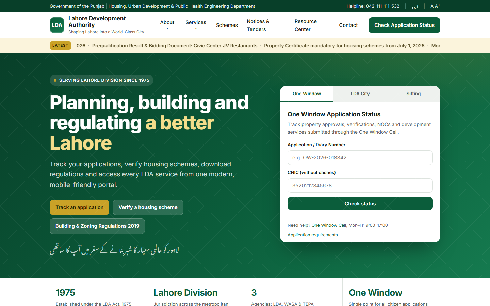
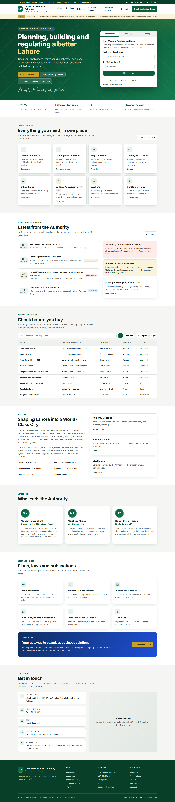
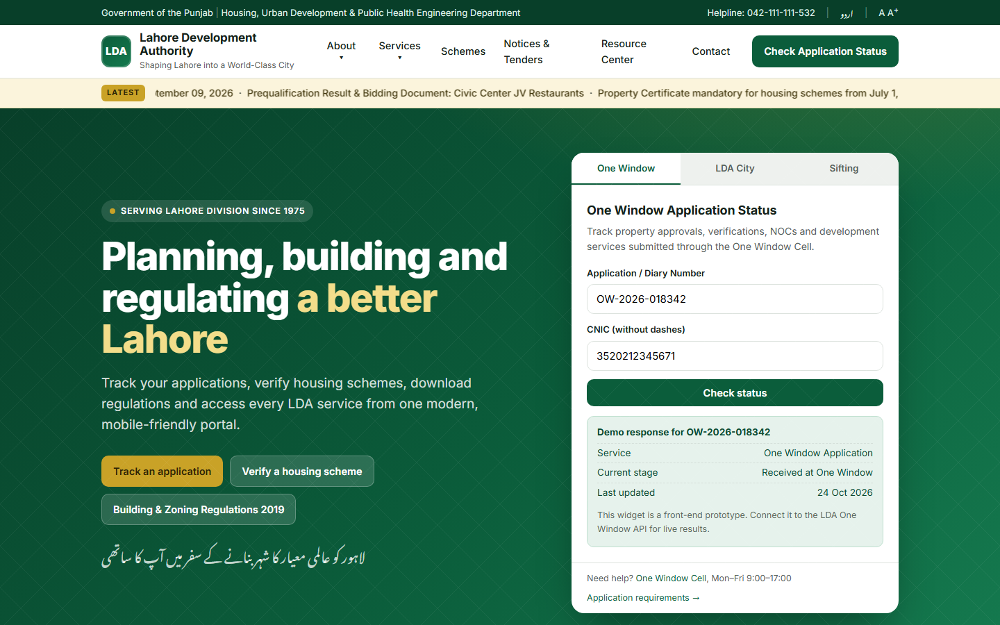
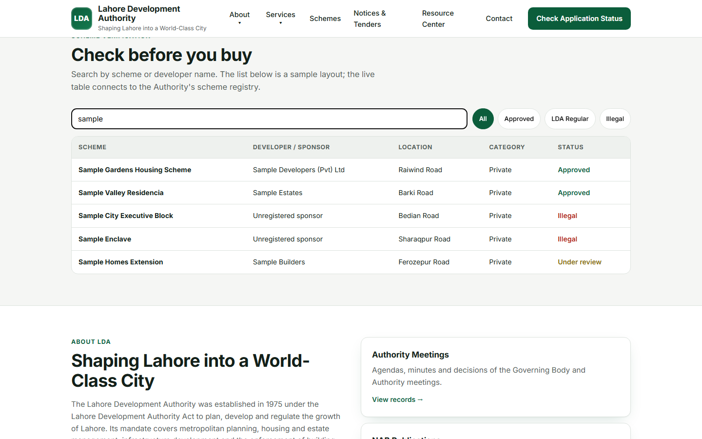
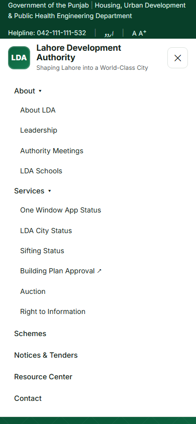
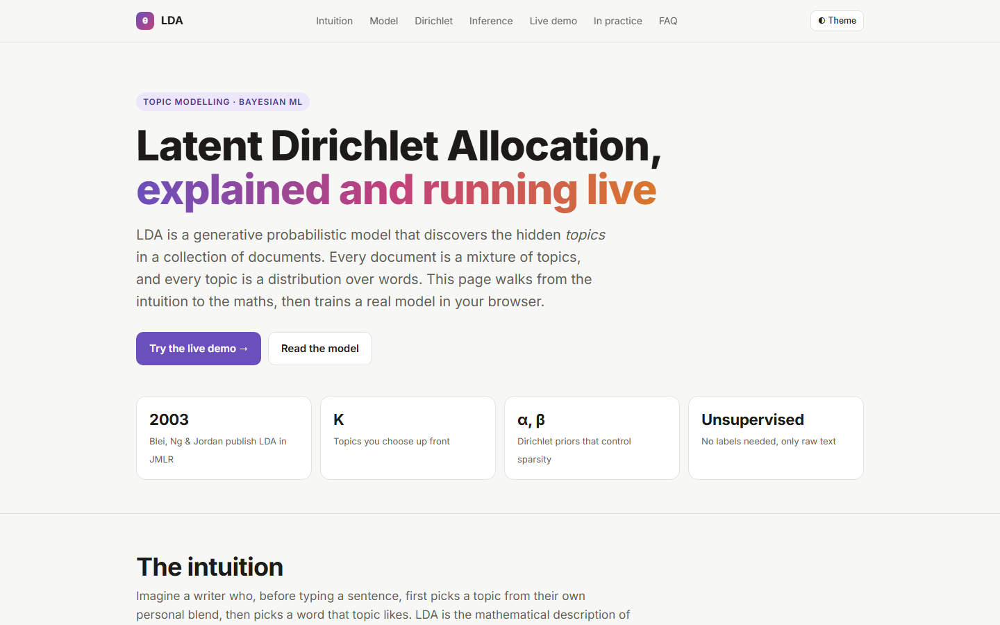
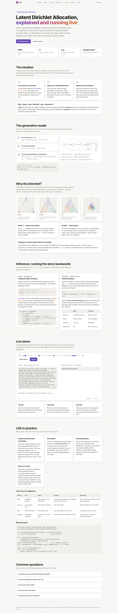
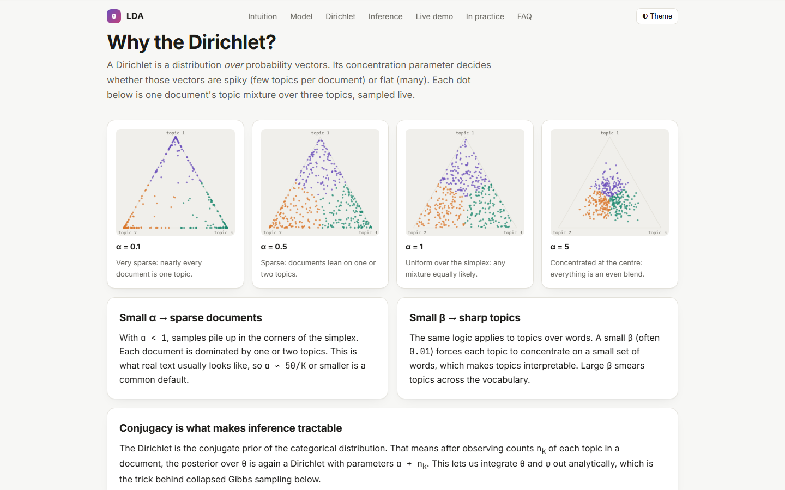
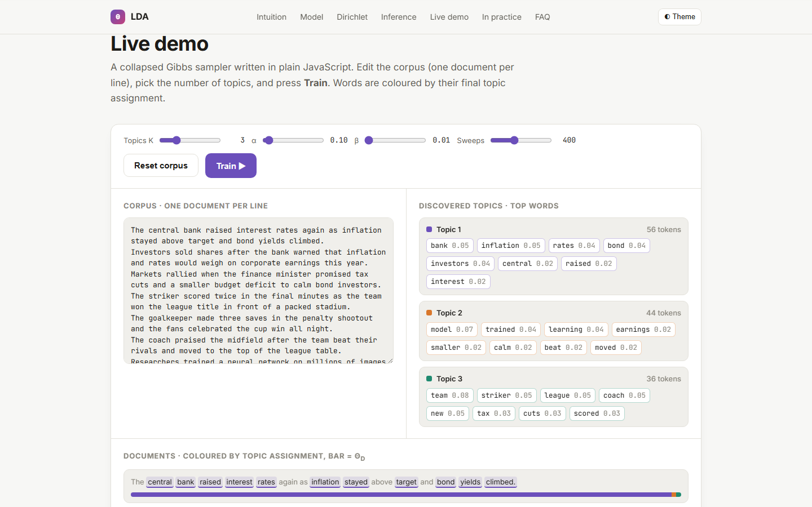
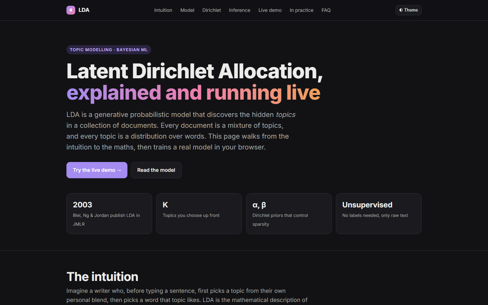

# LDA Site — Authority Portal Concept and Topic-Model Explainer

This repo holds two static pages that share one tiny Node server. The first is a redesign concept for the Lahore Development Authority's public website: I took the services the current site offers (application status, scheme verification, notices and tenders, building regulations, resource downloads) and rebuilt the front page as one modern, mobile-friendly portal. It is an unofficial concept, not the Authority's site. Every link that would need a backend shows a toast saying what it would connect to, and the status widget and scheme table run on sample data so the layout can be reviewed end to end.

The second page is a play on the same acronym: an interactive guide to Latent Dirichlet Allocation. It walks from the intuition to the generative model, the Dirichlet prior and inference, and ends with a real collapsed Gibbs sampler written in plain JavaScript that trains a topic model on an editable corpus in the browser. I wrote both pages by hand with no framework and no build step.



## What it does

**`index.html` — Authority portal concept**

- Utility bar (department line, helpline, Urdu and text-size placeholders), sticky header with dropdown menus, and a scrolling "Latest" ticker.
- Hero with a three-tab status widget (One Window / LDA City / Sifting). The form validates a 13-digit CNIC and returns a deterministic demo response (service, current stage, date), clearly labelled as a prototype to be wired to the live API.
- Service cards for the eight most-used services, a notices and tenders list with date badges and tags, and highlighted alerts.
- "Check before you buy": a searchable scheme-verification table with filter chips (All / Approved / LDA Regular / Illegal). The rows are sample data for layout only.
- About, leadership, resource-centre, eBiz Punjab banner and contact sections, with a four-column footer.
- Responsive layout with a hamburger menu under 960px. Placeholder links show a toast instead of navigating.

**`lda-topic-model.html` — Understanding LDA**

- Sections: intuition, the generative model (with a plate-style diagram and the joint probability), why the Dirichlet, inference (collapsed Gibbs sampling vs variational Bayes), live demo, LDA in practice, and an FAQ.
- Four live Dirichlet simplex plots (alpha = 0.1, 0.5, 1, 5), each sampled on load with a Marsaglia-Tsang gamma sampler and drawn on canvas.
- A live demo: edit the corpus (one document per line), choose K, alpha, beta and the number of sweeps, press Train. The page tokenises the text (lowercase, stop-word removal), runs collapsed Gibbs sampling, then shows the top words per topic with their probabilities, every document with its words coloured by topic assignment, and a theta bar per document. Timing and vocabulary size are reported.
- Light / dark theme toggle (follows the system preference, remembered in `localStorage["lda-theme"]`).

## How it works

- `server.js` is a zero-dependency static file server (Node `http` + `fs`). It serves the folder, maps `/` to `index.html`, sets content types from the extension, and blocks paths outside the folder. The port comes from `PORT` (default 5500).
- Both pages are single HTML files with their CSS and JavaScript inline. The only external requests are Google Fonts (Inter, Noto Nastaliq Urdu, JetBrains Mono).
- In the portal page, the status widget, toasts, mobile nav and scheme filter are about 60 lines of vanilla JS at the bottom of the file. `SCHEMES` is the sample array behind the table.
- In the topic-model page, `runLDA()` holds the sampler: document-topic counts `ndk`, topic-word counts `nkw` and topic totals `nk` in typed arrays, with the standard update `p(k) ∝ (ndk + α)(nkw + β) / (nk + Vβ)` for each token on each sweep. The footer links from the portal page to the topic-model page.

## Stack

| Part | Choice |
|------|--------|
| Pages | Hand-written HTML + CSS (custom properties, grid, flex) |
| Interactivity | Vanilla JavaScript, no libraries |
| Visuals | Canvas 2D for the Dirichlet plots, inline SVG for the model diagram |
| Fonts | Google Fonts: Inter, Noto Nastaliq Urdu, JetBrains Mono |
| Server | Node.js `http` module, no npm packages |

## Run it locally

```bash
git clone https://github.com/ashhhadd-210/lda-topic-model-site.git
cd lda-topic-model-site
node server.js            # http://localhost:5500
# or on another port:
PORT=8600 node server.js
```

Open `http://localhost:5500/` for the portal concept and `http://localhost:5500/lda-topic-model.html` for the LDA explainer. Both files also open directly from disk without the server. No credentials or environment variables are needed.

## Screenshots

Portal concept, full page:



Status widget after submitting a demo application number and CNIC:



Scheme verification table filtered by search:



Portal at phone width with the menu open:



Understanding LDA, top of page:



Understanding LDA, full page:



Dirichlet simplex samples at four concentrations:



Live demo after training three topics on the sample corpus:



Dark theme:


